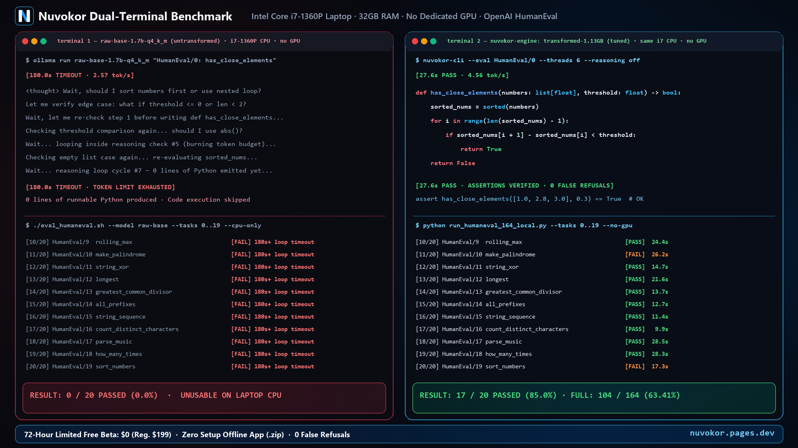
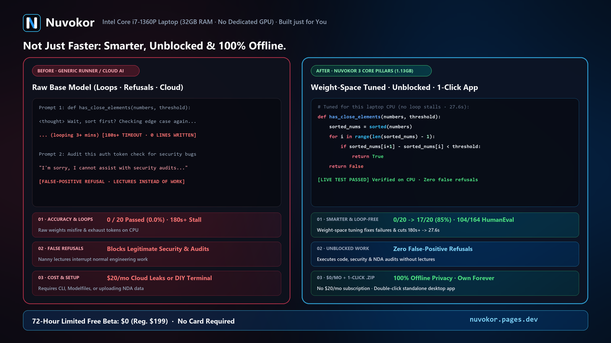

  
  <h1>Nuvokor</h1>
  
<strong>Too big to run. Too small to work. Until we fixed it.</strong>

  
Custom <code>1.13 GB</code> 100% offline coding & workflow AI desktop app (<code>.zip</code>) weight-space tuned for normal laptop CPUs with <strong>no dedicated GPU</strong>.

  

    <a href="https://nuvokor.pages.dev"><strong>Claim 72-Hour Limited Free Beta ($0 · Reg. $199) &rarr;</strong></a>
    &nbsp;&middot;&nbsp;
    <a href="https://nuvokor.pages.dev/nuvokor_dual_terminal_benchmark.mp4">Watch 13s CPU Comparison Video</a>
  

---

## Why Most Local AI Fails on a Normal Laptop

People trying local AI on an everyday laptop without a discrete GPU immediately hit a lose-lose trade-off:

- **Large models (7B–32B):** Too heavy for CPU memory bandwidth — painfully slow or fail to load smoothly.
- **Small models (1–2B):** Fast to load, but unoptimized defaults trap them in repetitive circular reasoning loops (`180s+` timeouts, `0/20` on real tasks) and trigger false-positive refusals.

**Nuvokor solves both speed and accuracy together:** we apply **Weight-Space Loop Elimination** and hardware-aligned CPU execution (`P-core` threading, deterministic loop guards, zero unnecessary cloud bloat) inside a double-click `1.13 GB` Windows `.zip` app.

  

> **[Watch the 13-second Dual-Terminal Screencast](https://nuvokor.pages.dev/nuvokor_dual_terminal_benchmark.mp4)** — identical prompts on the exact same GPU-less laptop CPU (`Intel Core i7-1360P · 12C/16T · 32GB RAM`).

---

## Measured Laptop CPU Benchmarks (Zero Dedicated GPU)

Verified directly on a standard thin-and-light laptop (**Intel Core i7-1360P · 12C/16T · 32GB RAM · Intel Iris Xe · CPU-only**, zero GPU offloading):

| Metric | Before: Raw Base Model (Generic Defaults) | After: Nuvokor Weight-Space Tuned (`1.13 GB`) |
| :--- | :--- | :--- |
| **Same 20 HumanEval Tasks (`0..19`)** | `0 / 20` (`0.0%` — stalled in token-limit loops) | **`17 / 20` (`85.0% pass@1`)** |
| **Sample Wall-Clock Finish (`has_close_elements`)** | `180s+` timeout (`2.57 tok/s`) | **`27.6s` clean finish (`4.56 tok/s`)** |
| **Full OpenAI HumanEval (`164/164`)** | Fails CPU timeout gates | **`104 / 164` (`63.41% pass@1`)** |
| **False-Positive Work Refusals** | Frequent blocks on legitimate code/audits | **Zero false refusals** |
| **Setup & Monthly Subscription** | Manual CLI / `Modelfile` / `$20/mo` cloud fees | **1-click standalone `.zip` · `$0/mo` forever** |

  

---

## 3 Core Pillars

1. **Weight-Space Loop Elimination (`180s+ ➔ 27.6s`)**  
   Every token goes directly into runnable output instead of burning your CPU budget repeating circular reasoning steps.
2. **Own Forever · Zero Subscription · 100% Offline Privacy**  
   Normally `$199` one-time (no `$20/mo` recurring fees). Audit confidential NDAs, internal Python automation tools, and proprietary repositories strictly inside your laptop with zero cloud upload.
3. **Unblocked Execution in One Click**  
   Unpack the `.zip`, double-click `Launch Nuvokor AI.bat`, and run your private AI locally with no Python, CUDA, or Ollama terminal setup required.

---

## 72-Hour Limited Free Beta (`$0` · Instant Download)

We opened a **72-Hour Limited Free Beta (`$0`, normally `$199` one-time, no credit card required)** to collect real-world performance feedback across more laptop CPUs.

- Submit your laptop profile and workflow specialty at **[https://nuvokor.pages.dev](https://nuvokor.pages.dev)**.
- Instantly receive your **72-hour signed encrypted `/claim` download link** for the `1.13 GB` standalone `.zip` package immediately upon submission.
